# Gudotopia - Java Swing gardening game

Java 17+ / Swing / Java2D with plain-text saves. No external libraries.
Grow 12 collectible flowers (5 Common, 4 Rare, 3 Legendary - the rare and legendary ones are classmates), sell them, and fill your collection.

## Screenshots
One normal game, from the menu to a saved garden (files in `docs/screenshots/`).

| | | |
|---|---|---|
| 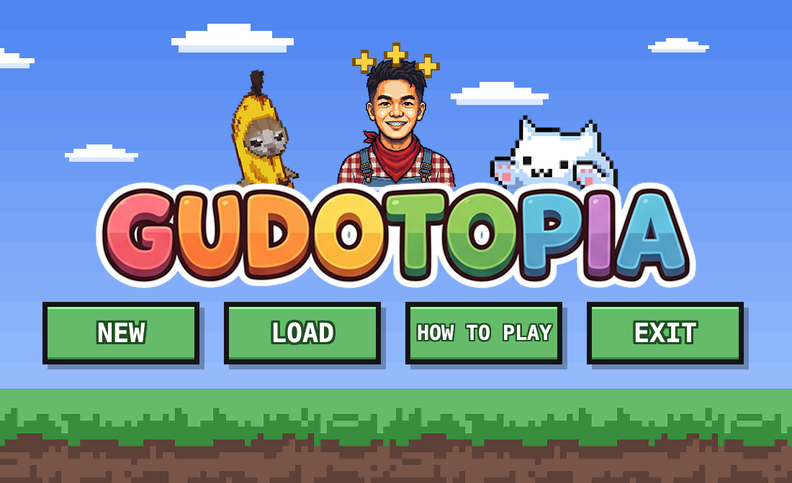 | 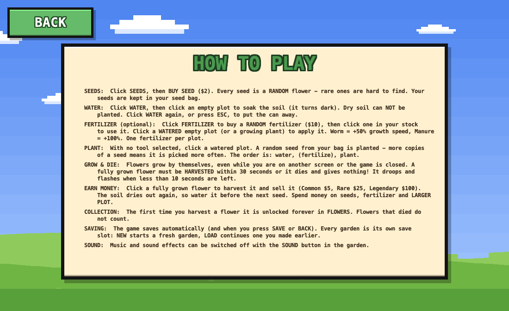 | 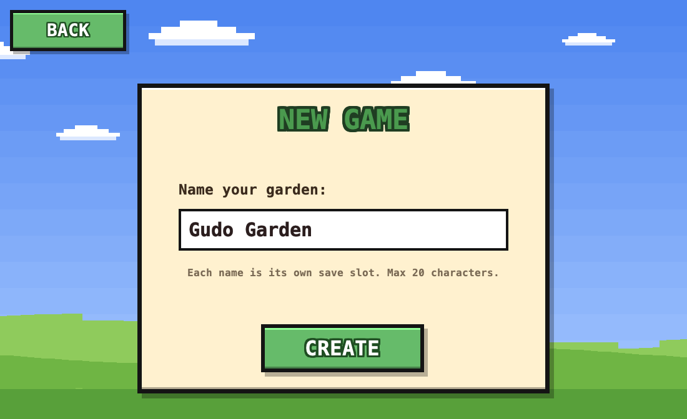 |
| Main menu | How to play | New game: name your garden |
| 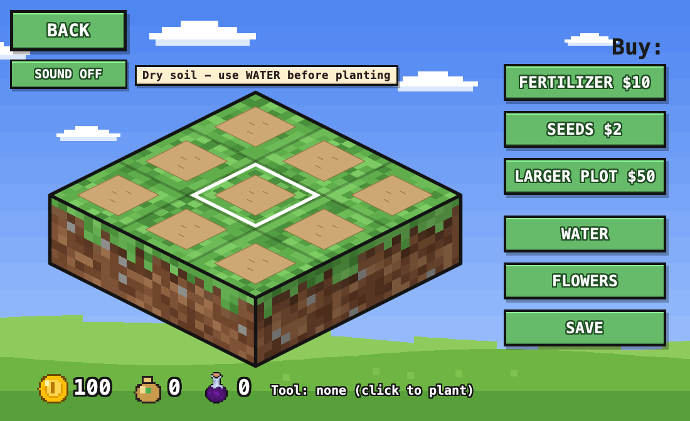 | 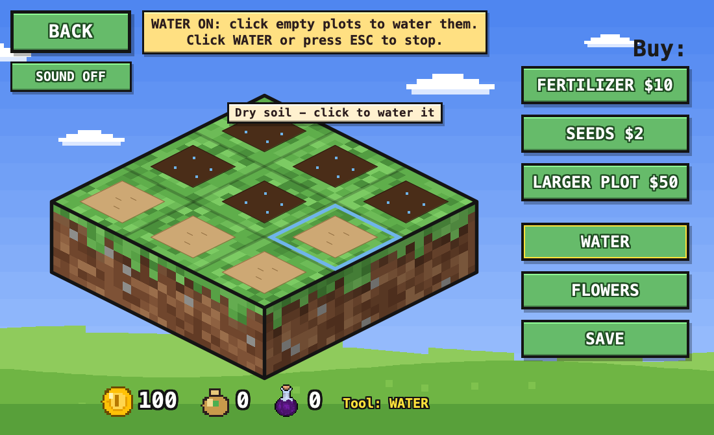 | 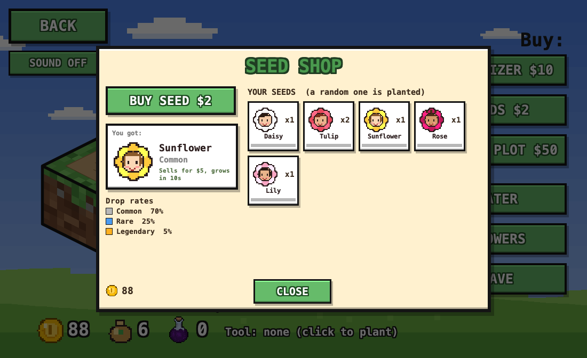 |
| A new garden: dry soil | WATER tool: soaking plots | Seed shop: random seeds |
| 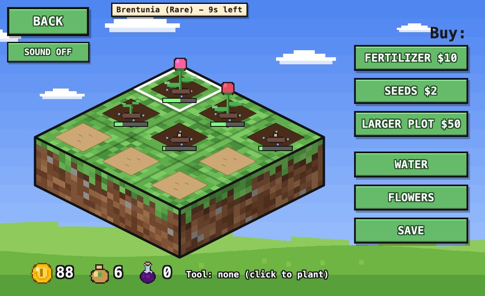 | 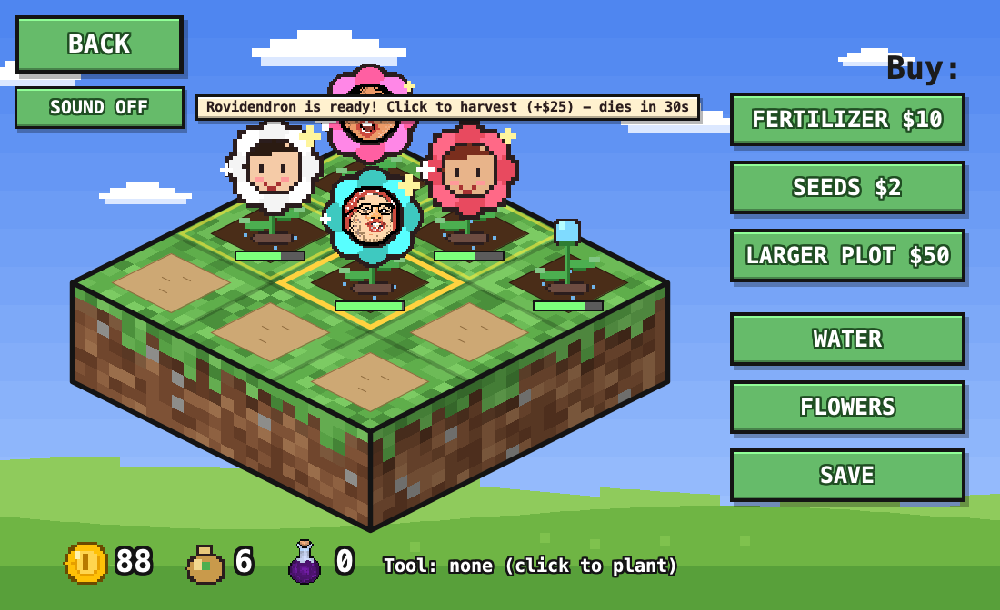 | 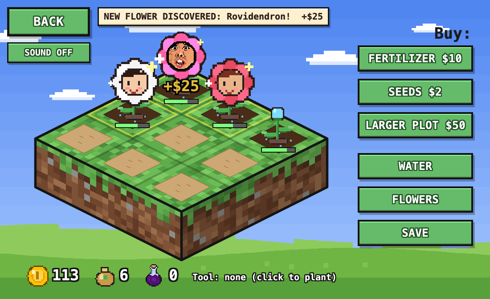 |
| Plants at different growth stages | Flowers ready to harvest | Harvest: new flower discovered |
| 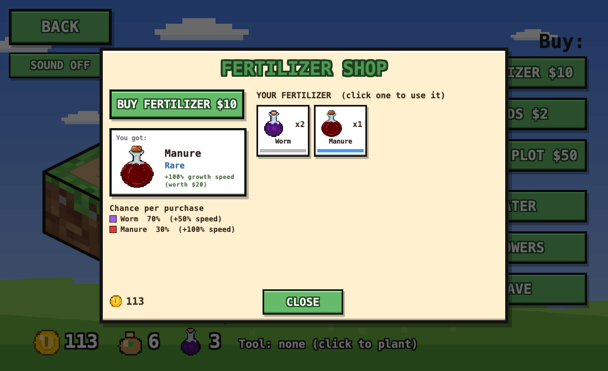 | 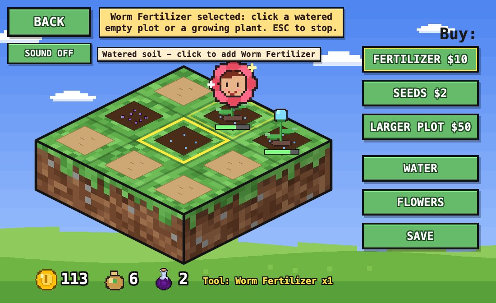 | 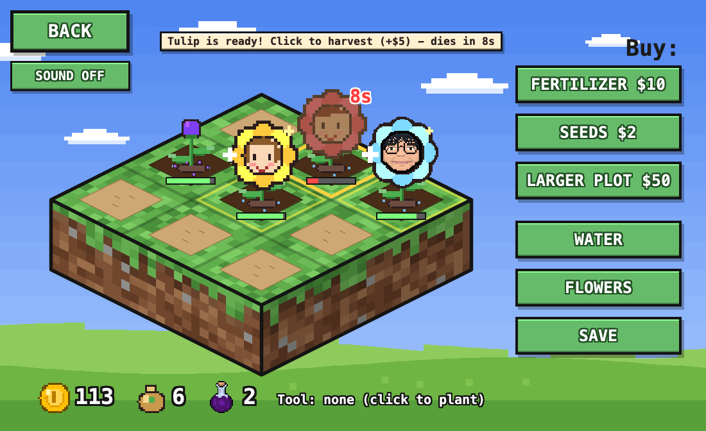 |
| Fertilizer shop | Fertilizer on the soil | A flower about to wither |
| 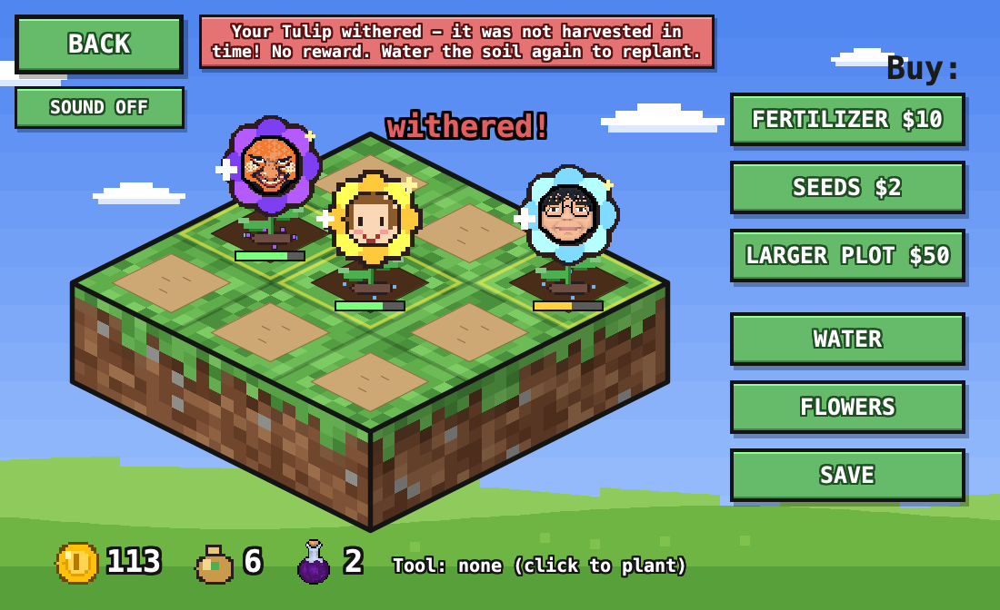 | 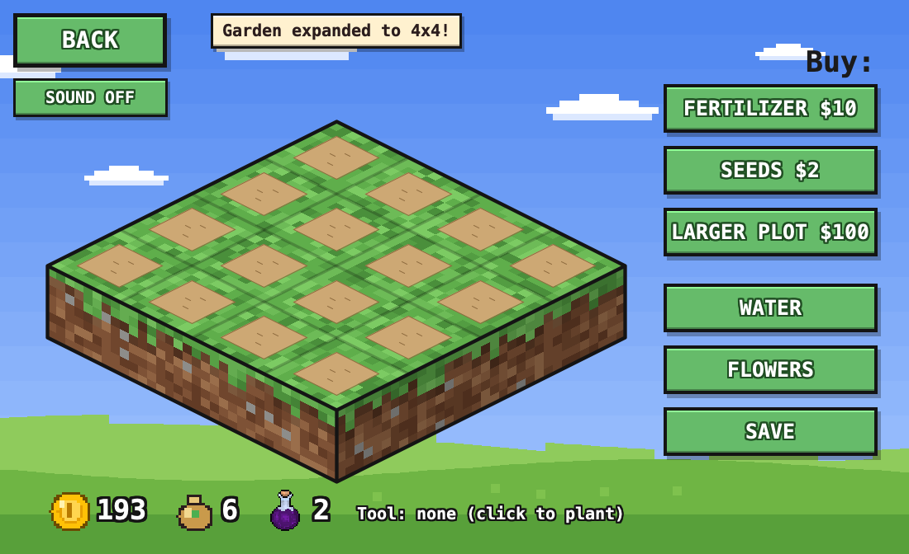 | 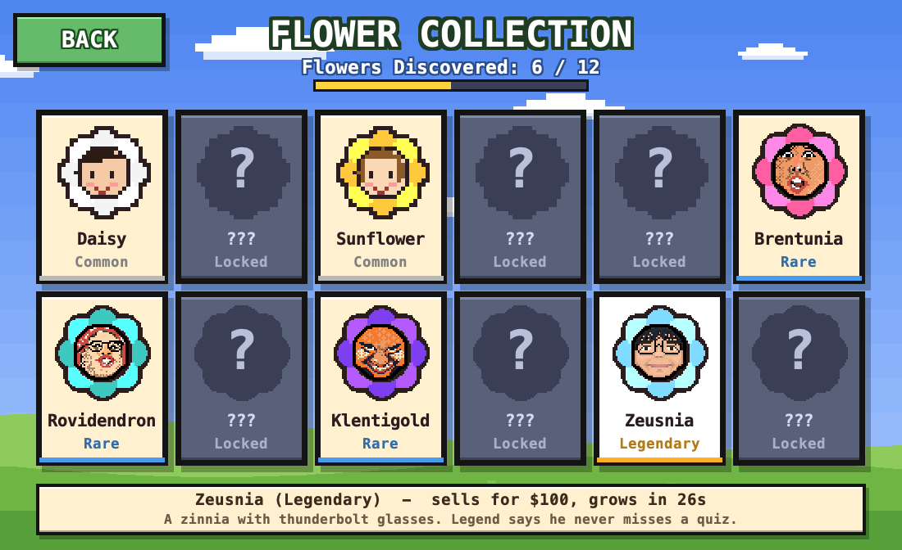 |
| Withered: no reward | Larger plot (4x4) | Flower collection |
| 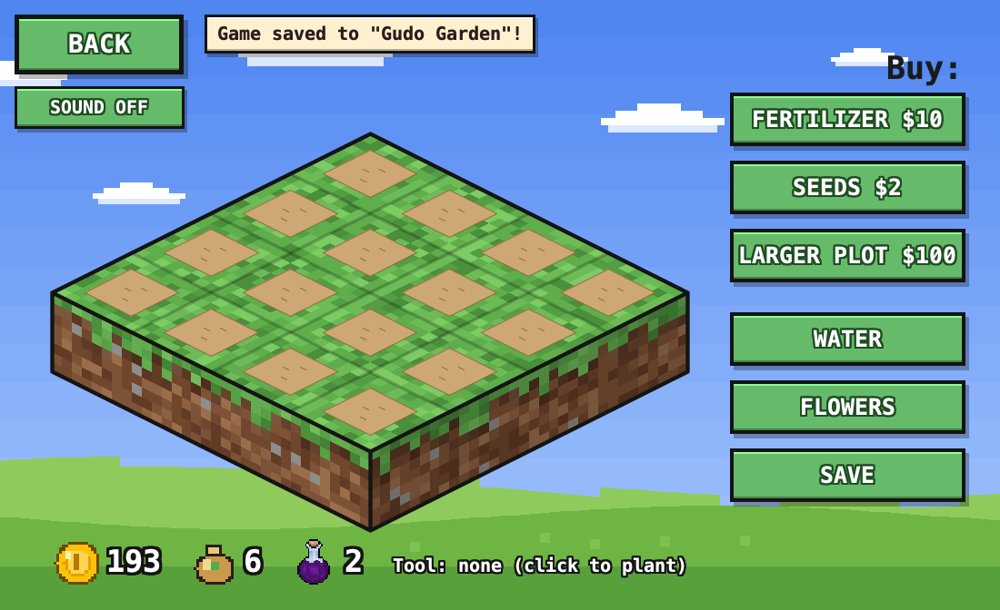 | 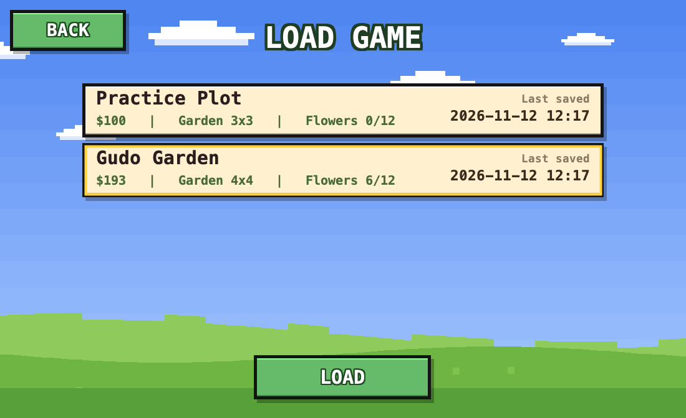 | |
| Game saved | Load game | |

## Run in IntelliJ IDEA
File > Open the `Gudotopia` folder, right-click `src` > Mark Directory as > Sources Root (Project SDK: Java 17+),
then run `src/Main.java`. (`pom.xml` is optional: opening it as a Maven project works too.)
Run configuration > Working directory must be the project root (the default), so `assets/` is found.

## Run from a terminal
    ./run.sh            (Linux/macOS)        run.bat  (Windows)

## Where is the data?
One text file per save: `~/.gudotopia/saves/save_1.properties`, `save_2.properties`, ...
(Windows: `C:\Users\<you>\.gudotopia\saves\`). The folder is hidden because its name starts with a dot.
Open a file in Notepad to see `money=`, `seed.daisy=2`, `plot.1.1.watered=1`, ...

## Design patterns (GoF)
* **Singleton:** `SaveManager.getInstance()` (one save service) and `AudioManager.getInstance()` (one audio player).
* **Factory Method:** `ItemFactory` with `SeedFactory` and `FertilizerFactory`, used by `PlayerData.buySeed()/buyFertilizer()`.

## Files (all in `src/`)
| File | Job |
|---|---|
| Main | entry point |
| GameFrame | window, screen switching (CardLayout), owns PlayerData + SaveManager, starts the music |
| ScreenPanel | base screen: sky, drifting clouds, Swing Timer (~30 fps) |
| MainMenuPanel / MenuArt / HowToPlayPanel | title screen + its pictures / instructions |
| NewGamePanel / LoadGamePanel | create a named save / choose a save |
| GardenPanel | isometric garden, mouse clicks on plots, HUD, toasts, SOUND button |
| ShopPanel | right-hand FERTILIZER / SEEDS / LARGER PLOT / WATER / FLOWERS / SAVE buttons |
| ItemDialog / SeedDialog / FertilizerDialog | shared shop pop-up and its two versions |
| FlowerCollectionPanel | encyclopedia grid, locked = silhouette, "Discovered x / 12" |
| PlayerData | **all game rules**: money, seeds, plant, harvest, fertilize, expand (no Swing) |
| GardenPlot / SeedInventory / FertilizerInventory | one plot's growth state / owned seeds / owned fertilizer |
| Flower / Rarity / FlowerRegistry | flower data, **drop rates + rewards**, the 12-flower table |
| Fertilizer / FertilizerRegistry | fertilizer items and shop odds |
| ItemFactory / SeedFactory / FertilizerFactory | Factory Method: how the shop creates a random item |
| SaveManager / SaveInfo / SaveException | Singleton: reads/writes the save files / one row of the load list / save errors |
| AudioManager | Singleton: background music + sound effects from `assets/sounds/` |
| GameConfig | timings (30 s death timer etc.) |
| PixelArt / GameRenderer / PixelButton | drawn sprites + image loading, drawing helpers, custom button |

## Assets
* `assets/flowers/<id>.png`: a classmate's face (e.g. `klent.png`), drawn 1:1 in the middle of petals in the flower's colour. A flower without a file (the commons) gets a cute face drawn in code. See the README there.
* `assets/icons/<name>.png`: icons that replace the drawn ones. The two potions (`fert_worm.png`, `fert_manure.png`) are the fertilizer icons. See the README there.
* `assets/sounds/*.wav`: `bgm` (looping music), `click`, `plant`, `water`, `fertilize`, `harvest`, `discover`, `buy`, `error`, `wither`.
  Replace any file with your own WAV of the same name. Missing = silence.
* `assets/menu/`: main-menu pictures. `assets/fonts/`: optional pixel font.

## Tweaking
* Drop rates, rewards, growth times: `Rarity.java` (rates must total 100 - checked at startup).
* Flower names/rarities/colours: table in `FlowerRegistry.java`.
* Fertilizer price/odds: `FertilizerRegistry.java`. Seed price and expansion costs: top of `PlayerData.java`.
* Timings (JVM options): `-Dgudotopia.deathSeconds=30 -Dgudotopia.warningSeconds=10 -Dgudotopia.growthScale=1.0 -Dgudotopia.autosaveSeconds=15 -Dgudotopia.dir=<folder>`.

## Tests (optional)
    javac -d out src/*.java test/*.java
    java -Djava.awt.headless=true -cp out GameTest          (game rules)
    java -Djava.awt.headless=true -cp out SaveFileTest      (save files; uses a temp folder)
(`UiCheck` drives the real window with a robot and needs a display.)
